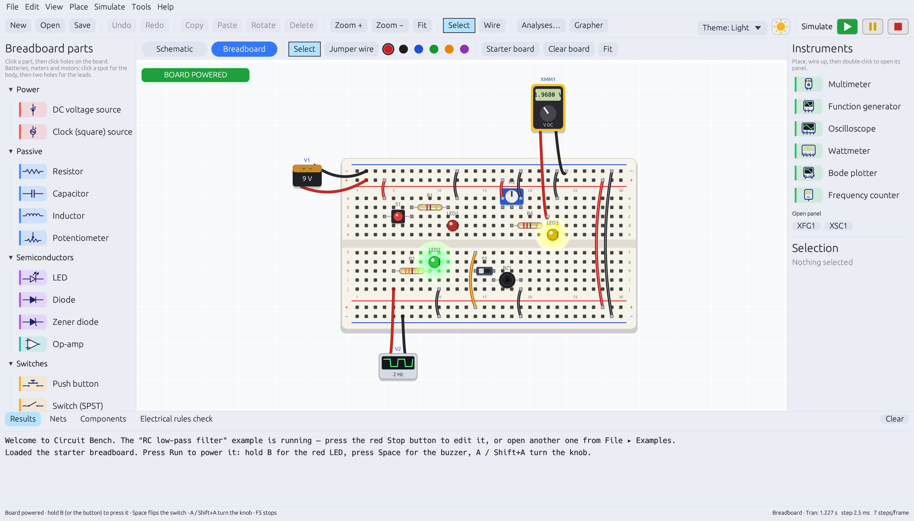
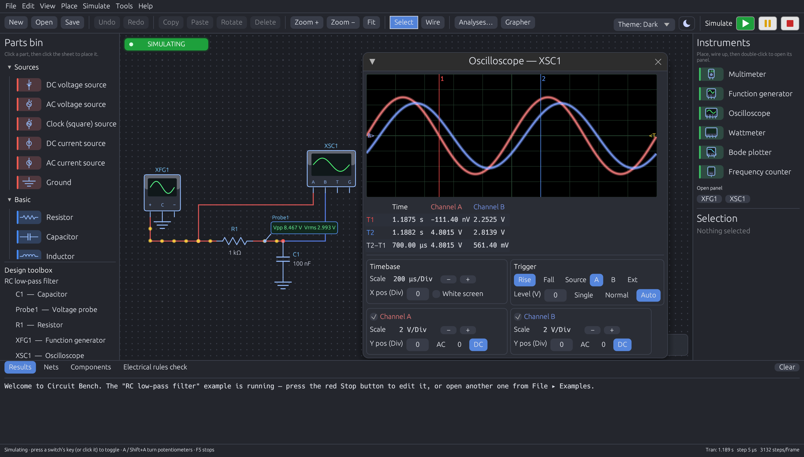
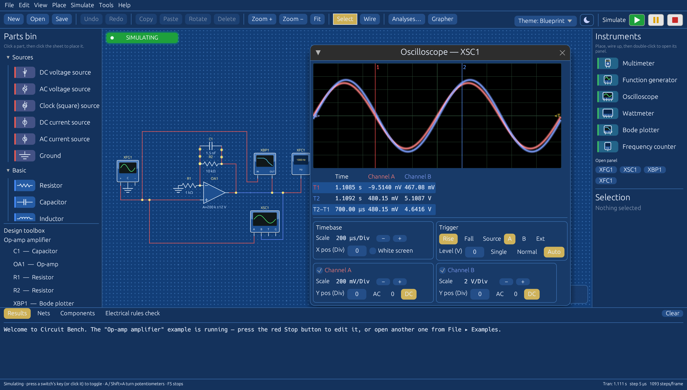

# Circuit Bench

A circuit design and simulation bench: draw schematics or build on a 2D breadboard,
then run them live with meters, an oscilloscope, a Bode plotter and more.



| Schematic with a live oscilloscope (Dark theme) | Op-amp amplifier (Blueprint theme) |
| --- | --- |
|  |  |

## Features

- **Schematic editor**: parts bin, grid, wiring by clicking pins, move/rotate/copy/undo, properties for every part.
- **2D breadboard**: power rails and connected strips, realistic parts, coloured jumper wires; hover a hole to see what it is joined to.
- **Live simulation**: LEDs glow, lamps light, motors spin, buzzers sound off visually, fuses blow, current flows along wires.
- **Instruments**: multimeter, function generator, 2-channel oscilloscope, wattmeter, Bode plotter, frequency counter.
- **Analyses**: DC operating point, AC sweep, transient and DC sweep, shown in a grapher with CSV export.
- **Parts**: resistors, capacitors, inductors, potentiometer, fuse, DC/AC/clock sources, diodes, Zener, LEDs, op-amp,
  switches and push buttons, lamp, motor, buzzer, voltmeter, ammeter, probe.
- **Themes**: Light, Dark, Midnight, Blueprint, Sepia and Forest.
- Save/open circuits, SPICE netlist export, nine example circuits.

## Download

Ready-made builds for Windows, macOS and Linux are on the **Releases** page of this repository.

## Build it yourself

### Windows

1. Install Rust once from https://rustup.rs (default options; when it offers the
   Microsoft C++ build tools, accept them).
2. Double-click `build-windows.bat` in this folder.
3. Start `dist\CircuitBench.exe`.

Settings (theme, grid, animations) are kept in `%USERPROFILE%\.circuit_bench_settings.json`.
Circuits are saved as `.cbs` files, by default in your Documents folder.

### macOS

1. Install Rust once from https://rustup.rs.
2. In Terminal, in this folder, run `sh build-mac.sh`.
3. Open `dist/Circuit Bench.app` (first time: right-click it and choose **Open**, because the app is not signed by Apple).

The downloaded Mac build from Releases is a universal app that runs on both Apple-chip and Intel Macs.

### Linux

```
cargo build --release
./target/release/circuit_bench
```

Linux also needs the usual desktop graphics libraries (X11/Wayland, OpenGL) that most desktops already have.

## Options

- `--example <n>` open a built-in example (0–8)
- `--view breadboard` start on the breadboard
- `--theme <Light|Dark|Midnight|Blueprint|Sepia|Forest>`
- `--screenshot <file.png>` draw a few frames, save a picture and quit

## Publishing a release

Every push builds the app for all three systems automatically (see the **Actions** tab).
To publish downloads, create a tag that starts with `v` (for example `v1.0.0`) — on GitHub:
**Releases → Draft a new release → Choose a tag → type `v1.0.0` → Publish**. The builds are attached to it a few minutes later.

## License

MIT — see [LICENSE](LICENSE).
